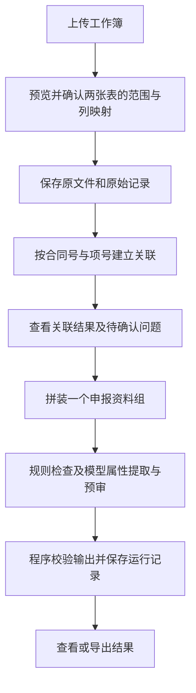

# 出口关务预审 MVP 技术方案与数据设计

版本 v0.1，更新于 2026-11-11。本文用于指导当前 Streamlit 原型的后续开发，配套 [SQLite 建表脚本](sqlite_schema.sql)。

> 状态说明（2026-11-13）：本文描述的 Streamlit 原型已完成全链路验证，代码与运行数据库已清理，不进入仓库；本文与建表脚本作为设计参考保留，文中「已实现」均指原型阶段的历史状态。当前开发主线以 [开发任务与阶段交付计划](开发文档/开发任务与阶段交付计划.md) 为准。

## 1. 当前状态与选型

采用 Streamlit + Python + SQLite 完成单机验证，后续多人试点迁移到 Django + 云托管 PostgreSQL，并增加后台任务进程。Excel 解析、关联、属性提取和预审逻辑保留为独立 Python 模块。

| 部分 | 已实现 | 下一步设计 |
|---|---|---|
| 页面 | 上传 XLSX、选择单个 Sheet、跳过尾部行、空值检查、结果下载 | 双 Sheet 导入、关联预览、资料组预审与历史结果查看 |
| 规则 | 多字段空值判断、输出具体缺失字段 | 跨表关联和资料冲突检查 |
| 模型 | 固定虚构商品资料的文字预审，用户已反馈调用成功 | 实际资料组输入、属性 JSON 提取、输出校验和保存 |
| 数据 | 运行期间的 pandas 表格 | SQLite 原始记录、关联关系、模型运行记录 |
| 图片 | 当前模型请求为纯文本 | 保留图片引用，后续实现图片提取和模型图片输入 |
| 复核 | 由用户阅读页面结果 | 先用专家标注样本验证，多角色复核留痕在试点阶段实现 |

当前代码为 `app.py`、`audit.py`、`llm.py`、`db.py`、`importer.py`、`history.py`、`agent.py`、`skills.py`、`review.py`。自动入库、历史种子与匹配、属性提取 agent、硬编码 skill 路由初审与运行留痕已实现（见 `smoke_test.py`）；跨表关联与人工确认页面属于待实现设计。旧 PRD、沟通记录和 11 月 4 日方案保留需求演变过程，本轮 Streamlit MVP 按本文推进。

## 2. 样表核查与数据粒度

本次核查用户提供的供应商工作簿，共 13 个 Sheet，其中两张用于当前资料拼装。

| Sheet | 表头 | 商品数据范围 | 作用 |
|---|---|---|---|
| 节点①申报要素 | 第 1 行 | 第 2–48 行，共 47 条 | 填报品名、HS 编码、申报要素、图片及已有意见 |
| 节点①装箱明细 | 第 4 行 | 第 5–68 行，共 64 条 | 合同项、物料、规格、厂家型号和拆箱明细 |

这些范围是当前样表的核查结果。每次导入由解析配置记录实际表头、数据范围和字段映射，范围确认后再入库。

首版以申报表一行为一个预审资料组，对应零条、一条或多条装箱记录。组内各规格保留独立明细，提取属性时保留所属装箱源行。装箱记录有 59 个不同的合同号与合同项号组合，拆箱造成的重复是有效业务记录。

按合同号和正常升序项号范围展开，可建立 46 条申报记录与 60 条装箱记录的候选关联。已关联组按各组自身数量核对，当前样表数量一致。原始品名有表述差异，关联后继续保留两侧原文。

| 样表情况 | 设计处理 |
|---|---|
| 申报第 2 行对应装箱第 5、6 行 | 两条装箱记录均建立关联 |
| 项号包含 `24-25`、`15-17` 等范围 | 保留原表达式，按合同内项号展开后关联，并记录匹配方式 |
| 申报 C12 为 `55-27`，装箱第 19–21 行为项 55、56、57 | 记录为待确认问题，由人工决定对应关系并留原因 |
| 装箱第 68 行减速机在申报表无对应项 | 在待关联列表显示，保留原记录 |
| 申报 R、U 列部分合并 | 记录合并区域和锚点，按原语义读取包装、体积等组级值 |
| 申报 N:P、Z:AA 无标题但有内容 | 按列坐标保留原问答、修改意见和 OK 等文字 |
| 申报 M 列使用 DISPIMG，含单元格图片部件 | 保留图片公式与引用，图片提取和发送状态单独显示 |

图片公式及引用 ID 保存在对应源行的 `raw_cells_json`，图片映射和提取状态记录在批次的 `sheet_metadata_json`。原文件保留后，可从其中的图片部件继续提取。首个文本导入版本将图片状态初始化为“未提取／未提供模型”，并在页面显示。图片提取和视觉输入在后续单独验收。已有复核文字作为来源意见保留，正式复核状态在系统中单独记录。

## 3. 导入和关联流程



### 3.1 常用字段映射

| 标准字段 | 申报要素来源列 | 装箱明细来源列 |
|---|---|---|
| `contract_no` 合同号 | B | B |
| `item_ref` 合同项号原文 | C | E |
| `product_name` 商品名称 | F | G，合同第一条品名 F 另存原单元格 |
| `specification` 规格原文 | 申报要素全文保存在 `declaration_text` | H |
| `material_code` 物料代码 | 空 | D |
| `tax_category_code` 税分类代码 | D | 空 |
| `supplier_hs_code` 填报海关编码 | L | 空 |
| `declaration_text` 申报要素原文 | Y | 空 |

型号、数量、单位、厂家、意见及其他字段均保留在 `raw_cells_json`，根据需要选入资料组。编码、合同号和项号按文本处理，保留原值。数值单元格已经发生的精度损失需要回原资料核验。

`raw_cells_json` 以 A、B 等列坐标作为键，每个单元格保留原值、原表头、类型、公式和可用的缓存值。来源位置由 Sheet、Excel 行号与列坐标共同确定。解析只去除用于匹配的首尾空白，原单元格内容完整保留。

### 3.2 关联规则

1. 先限定上传批次和合同号，再按合同项号匹配。
2. 单项号生成 `exact` 关联，合法升序范围生成 `range` 关联。拆箱记录全部保留。
3. 倒序范围、未识别表达式、缺失关键字段或无法确定的匹配进入待确认列表。存在候选源行时建立 `needs_confirmation` 关联，完全无对应行时按来源记录展示未匹配问题。
4. 明确的规则匹配可以直接产生 `matched`。人工只处理歧义，调整后记录 `manual`、处理人、时间和原因。
5. 拼装采用 `matched` 的装箱记录，同时将相关待确认关联和未解决问题写入输入快照。
6. 首版一条装箱源行归属一个确定的申报资料组。重复或重叠项号造成竞争时，相关匹配进入 `needs_confirmation`，已有确定归属保留并提示冲突；数据库唯一索引防止同一装箱行被重复采用。确认调整归属时，在同一事务撤销旧关联再确认新关联。

## 4. SQLite 四张表

### 4.1 import_batches 上传批次

| 字段 | 含义 |
|---|---|
| `id` | 内部批次编号 |
| `original_filename`、`stored_file_path` | 原文件名和项目内保存位置 |
| `file_sha256` | 文件内容指纹 |
| `parser_version` | 解析程序版本 |
| `import_profile_hash` | 表头、范围、映射等解析配置的指纹 |
| `sheet_metadata_json` | Sheet、原表头、数据范围、字段映射及合并区域等配置 |
| `created_at` | 创建时间 |

同一文件指纹、解析版本、配置指纹只导入一个批次；批次是文件版本的技术载体，业务上归属审核任务。文件或配置改变时创建新批次，并作为同一审核任务的新文件版本。SQLite 和原文件建议放在项目已忽略的 `data/private/`、`uploads/` 中。

### 4.2 source_rows 来源记录

固定字段为 `id`、`batch_id`、`record_type`、`sheet_name`、`excel_row`、`contract_no`、`item_ref`、`product_name`、`specification`、`material_code`、`tax_category_code`、`supplier_hs_code`、`declaration_text`，其余原始内容保存在 `raw_cells_json`。

`record_type` 取 `declaration` 或 `packing`。一个批次、一个 Sheet、一个 Excel 行号只保存一条源记录。合同号与项号允许重复。导入后的源记录作为原始快照保存，修订资料以同一审核任务的新文件版本（新导入批次）导入。

### 4.3 row_links 关联关系

| 字段 | 含义 |
|---|---|
| `id`、`batch_id` | 关联编号及所属批次 |
| `declaration_row_id`、`packing_row_id` | 两侧来源记录编号 |
| `match_method` | `exact`、`range` 或 `manual` |
| `status` | `matched`、`needs_confirmation` 或 `rejected` |
| `note`、`updated_by` | 匹配依据或调整原因、处理人标记 |
| `created_at`、`updated_at` | 创建和修改时间 |

同一对来源行只保存一条当前关联。一条装箱行最多有一个 `matched` 关联，同时可以保留多个待确认候选。复合外键保证两侧来源行属于同一批次。应用写入前还需核对两侧类型分别为申报与装箱。修改关联时更新 `updated_at`，已执行审核的历史关联内容由运行快照保留。

### 4.4 audit_runs 提取与预审运行记录

| 字段 | 含义 |
|---|---|
| `id`、`batch_id`、`declaration_row_id` | 运行编号、批次、资料组主记录 |
| `input_hash`、`input_snapshot_json` | 本次资料和关联状态的指纹、完整输入快照 |
| `model`、`prompt_version`、`output_schema_version` | 模型及处理版本 |
| `status` | `running`、`succeeded` 或 `failed` |
| `raw_response_text` | 模型原始回复 |
| `attributes_json`、`issues_json` | 校验后的属性列表与问题列表 |
| `error_type` | 失败类型，使用程序错误类别 |
| `started_at`、`finished_at` | 起止时间 |

属性提取和初步资料预审可以在一次模型调用中完成。动态属性存入本表的 `attributes_json`，来源表继续保存导入事实。一次重试新增一条运行记录，相同输入也允许保留多次运行。

所有 JSON 字段使用 SQLite `TEXT`，建表脚本检查 JSON 格式和容器类型。属性字段、引用和业务含义由 Python 继续校验。表间关系为批次包含来源行、关联连接来源行、申报源行包含多次预审运行。

## 5. 商品资料组与动态属性

输入快照保存申报原文、逐条装箱明细、实际采用的关联、相关待确认问题、字段来源及实际发给模型的资料。每条装箱明细有独立 `source_row_id`，相同字段的不同规格分别保留。

首次实际资料测试，页面先预览将发送的商品技术字段。合同编号等关联标识可在本地使用，模型按内部来源编号引用资料。当前用户已确认使用云端中转模型，输入范围按用户选定的字段执行。

输出的外层结构固定，属性名称和数量可随商品变化。以下 ID 为结构示例。

```json
{
  "attributes": [
    {
      "name": "材质",
      "value": "丁腈橡胶",
      "sources": [
        {"source_row_id": 1, "cell": "Y2", "quote": "材质：丁腈橡胶"}
      ]
    }
  ],
  "issues": [
    {
      "type": "needs_confirmation",
      "field": "关联项号",
      "message": "合同项号范围需要确认",
      "sources": []
    }
  ]
}
```

处理顺序为规则解析明确的键值文本、模型补充自由描述提取、程序校验后保存。提取值必须有本次输入中的来源引用，引用文本可以在对应单元格原文找到。未知参数记录为待确认问题，冲突参数保留各自的值和来源。

校验同时检查 JSON 结构、属性名和值的类型、来源编号、单元格位置和引用文本。空列表表示本次确实没有提取项或问题，SQL NULL 表示结果尚未完成或失败。无论结构格式是否正确，当前模型输出均定位于资料完整性和内部矛盾预审。HS 归类合理性还需接入适用税则与要素规则并由人工复核。

单元格内容作为待审数据，模型提示词由程序提供。已有意见与供应商填报分开呈现，保留其来源身份。

## 6. 导入、重试与结果一致性

- 导入前计算文件和解析配置指纹，先检查批次是否已存在。批次及来源行在同一个短事务提交，解析或写入失败时整体回滚。
- 同时导入同一文件时，由批次唯一约束处理竞争，失败方读取已成功的批次。应用核对原文件保存成功后再提交数据库，按内容指纹保存文件可避免同名覆盖。
- 每个 SQLite 连接设置 `PRAGMA foreign_keys = ON`，使用参数化 SQL。模型调用在数据库事务外执行，运行前提交 `running`，结束后短事务写入成功结果或错误类型。
- 超时、网络失败、JSON 格式或引用校验失败均将本次运行记为 `failed`，保留原始资料和可用的原始模型回复。页面允许重试该资料组。
- 进程中断可能留下 `running`。确认原执行进程已结束后，将其中断运行结束为失败，再创建新运行，错误类别区分超时与进程中断。完成写入使用 `WHERE id = ? AND status = 'running'` 核对状态。
- 输入指纹来自规范化序列化的当前源资料、关联及确认状态、字段选择和实际模型输入。来源和关联按稳定编号排序后计算 SHA-256。模型、提示词和输出结构版本另行参与当前结果查询。
- 页面把当前输入指纹和处理版本一致的最新成功运行作为当前结果。关联调整后重新计算指纹，旧结果继续作为历史显示。
- `succeeded` 只表示模型处理和程序校验完成。专家意见、最终采用编码、审核人及多次复核版本在多人试点时增加独立复核记录表。

## 7. 模块与配置

| 模块 | 职责 | 状态 |
|---|---|---|
| `app.py` | 页面交互、输入预览、显示结果和错误 | 已有，已接入自动入库与初审结果展示导出 |
| `llm.py` | 读取模型配置、调用 Responses 接口、返回回复 | 已有 |
| `audit.py` | 空值规则，后续增加资料组拼装、提取提示词和输出校验 | 部分已有，空值检查保留为页面工具 |
| `db.py` | 连接管理、建库、历史成功数据初始化 | 已实现 |
| `importer.py` | 自动识别两表、探测表头、字段映射、保留 Excel 坐标和原单元格 | 已实现首版，人工确认映射页面待补 |
| `history.py` | 历史成功数据的确定性匹配（品名归一 + 型号词元） | 已实现首版 |
| `agent.py` | 属性提取 agent：拼装输入、调用模型、校验来源引用、失败重试 | 已实现简单固定步骤版 |
| `skills.py` | skill 注册表与硬编码路由，预留 planner agent 替换点 | 已实现硬编码版 |
| `review.py` | 逐行初审：历史命中或 skill 执行，运行留痕与当前结论 | 已实现 |
| `matching.py` | 单项、范围项、人工确认关联及异常列表 | 待实现 |

运行时配置采用 `OPENAI_API_KEY`、`OPENAI_BASE_URL`、`OPENAI_MODEL`。密钥通过 PyCharm 启动配置等环境变量提供，文档和日志记录变量名及错误类型。

当前 `llm.py` 已核对使用 `timeout=120.0`、`max_retries=0`、`DefaultHttpx2Client(trust_env=False)`。这些值用于当前联通测试，实际批量能力需另测。模型调用直接复用 OpenAI Python SDK，现阶段以固定处理步骤组织属性提取和资料预审。

当前运行需要 Streamlit、pandas、openpyxl、OpenAI SDK；SQLite 由 Python 标准库 `sqlite3` 提供。`requirements.txt` 已与实际导入对齐。当前业务代码未使用 FastAPI 和 Agents 编排。

## 8. 实现顺序与验收

| 步骤 | 交付物 | 验收重点 |
|---|---|---|
| 1 | SQLite 连接与两表原始导入 | 47 条申报和 64 条装箱明细可查，尾部合计备注按范围排除，重复导入复用批次 |
| 2 | 跨表关联预览 | 拆箱和正常范围完整保留，`55-27` 与孤立装箱行可见，跨批次和重复采用装箱行的关联被拒绝 |
| 3 | 单个资料组拼装与属性提取 | 用户能检查实际输入，逐规格保留，属性引用可追溯，未知和冲突形成问题 |
| 4 | 运行保存与导出 | 成功、超时、校验失败均有记录，关联变化后旧结果作为历史，失败可单独重试 |
| 5 | 专家样本验证 | 专家先独立标注，比较疑难行漏检、无效提醒和审核用时 |

样表范围与关联数字已只读核查。配套 SQL 只用于结构初始化，应用数据导入、实际资料组模型调用和多人复核需要按上述步骤实现验证。其他月份样表需补充验证字段映射及范围变化。

多人试点阶段增加 Django 页面、账号和权限、独立复核记录、PostgreSQL 与后台任务。迁移时保留来源坐标、原始单元格、输入快照和处理版本，JSON 文本可转换为 PostgreSQL JSONB。

## 9. 参考与文档入口

- [SQLite 建表脚本](sqlite_schema.sql)
- [早期需求沟通](沟通记录.md)
- [首期方案评估](首期方案评估.md)
- [数据源清单](数据源清单.md)
- [SQLite 外键说明](https://www.sqlite.org/foreignkeys.html)
- [SQLite JSON 函数](https://www.sqlite.org/json1.html)
- [SQLite 事务说明](https://www.sqlite.org/lang_transaction.html)
- [OpenAI Python SDK](https://developers.openai.com/api/reference/python)
